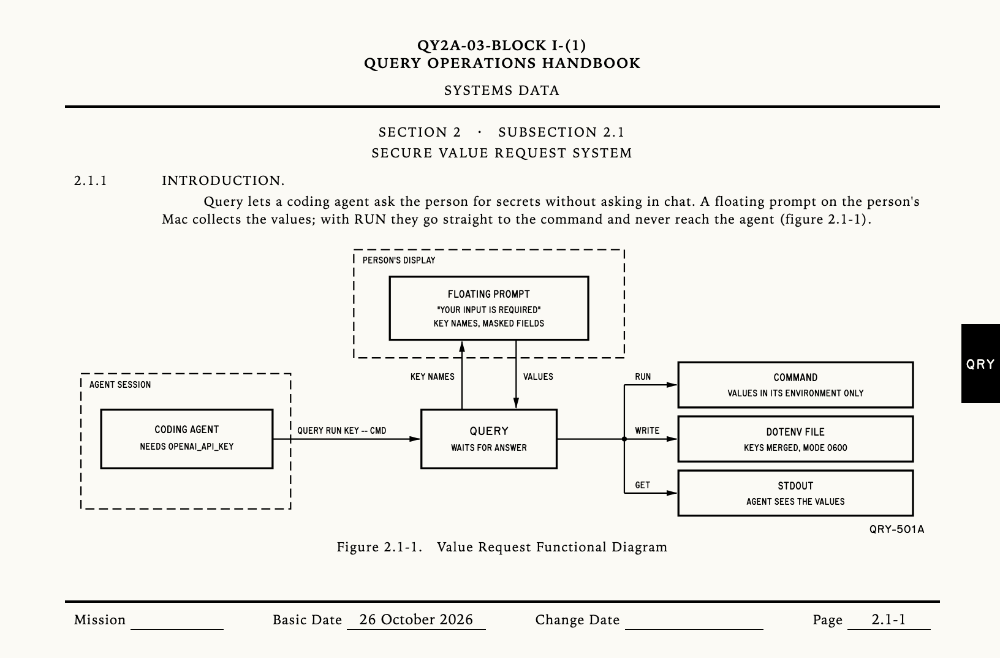

<p align="center">
  
</p>

# query

Let coding agents ask you for secrets without asking in chat.

An agent runs `query` with the names of the values it needs. A floating prompt
appears over whatever you are doing, you type or paste the values, and they go
straight to a command or a `.env` file. Nothing lands in the chat transcript,
and with `query run` the agent never sees the values at all.

```sh
query run OPENAI_API_KEY STRIPE_SECRET_KEY -- npm test
```

## Install

```sh
curl -fsSL https://raw.githubusercontent.com/R44VC0RP/query/main/install.sh | sh
```

This installs a universal binary (Apple silicon and Intel, macOS 14 or later)
to `~/.local/bin`. Set `QUERY_INSTALL_DIR` to put it somewhere else.

To build from source instead (Swift 5.10 or later):

```sh
git clone https://github.com/R44VC0RP/query.git && cd query
swift build -c release && cp .build/release/query ~/.local/bin/
```

## Usage

```sh
# Run a command with the values in its environment. They never reach stdout.
query run OPENAI_API_KEY -- npm test

# Merge the values into a dotenv file, written with mode 0600.
query write .env.local STRIPE_SECRET_KEY STRIPE_WEBHOOK_SECRET

# Print the values. Whoever reads stdout sees them, so not for secrets.
query get AWS_REGION --format export     # env, export or json
```

Add a hint after a colon to tell the person where to find a value:

```sh
query run "GITHUB_TOKEN:Fine-grained token, contents read" -- ./sync.sh
```

| Option | |
| --- | --- |
| `--reason TEXT` | Why the values are needed, shown on hover |
| `--timeout SECONDS` | Give up with exit status 124 if nobody answers |
| `--color COLOR` | `indigo` (default), `ember`, `jade`, `ocean`, `rose`, `gold`, `mono` or a hex color. Also read from `QUERY_COLOR`. |

Exit status is 0 when the values were provided, 1 when cancelled, 2 for a usage
error and 124 on timeout. With `run`, it is the command's own status.

In the prompt, Return moves to the next empty field and submits once every
field is filled. Esc cancels. Drag the card anywhere to move it.

## Agent skill

`skills/query/SKILL.md` teaches agents when and how to use `query`: `run` by
default, `write` only into git-ignored files, `get` only for values that are not
secret. Install it for your agents:

```sh
npx skills add R44VC0RP/query
```

## Permissions and limits

`query` needs no macOS permissions: no Accessibility, screen recording or input
monitoring. It only draws a window and reads what you type into it.

- It needs a logged-in desktop session, so it does not work over SSH, in CI or
  in containers.
- macOS asks the app running the agent, not `query`, for access when
  `query write` targets Desktop, Documents or Downloads.
- The release binary is not notarized. The install script downloads it with
  `curl`, which macOS does not quarantine, so it runs without a warning. A copy
  downloaded in a browser is blocked by Gatekeeper.

## License

MIT
